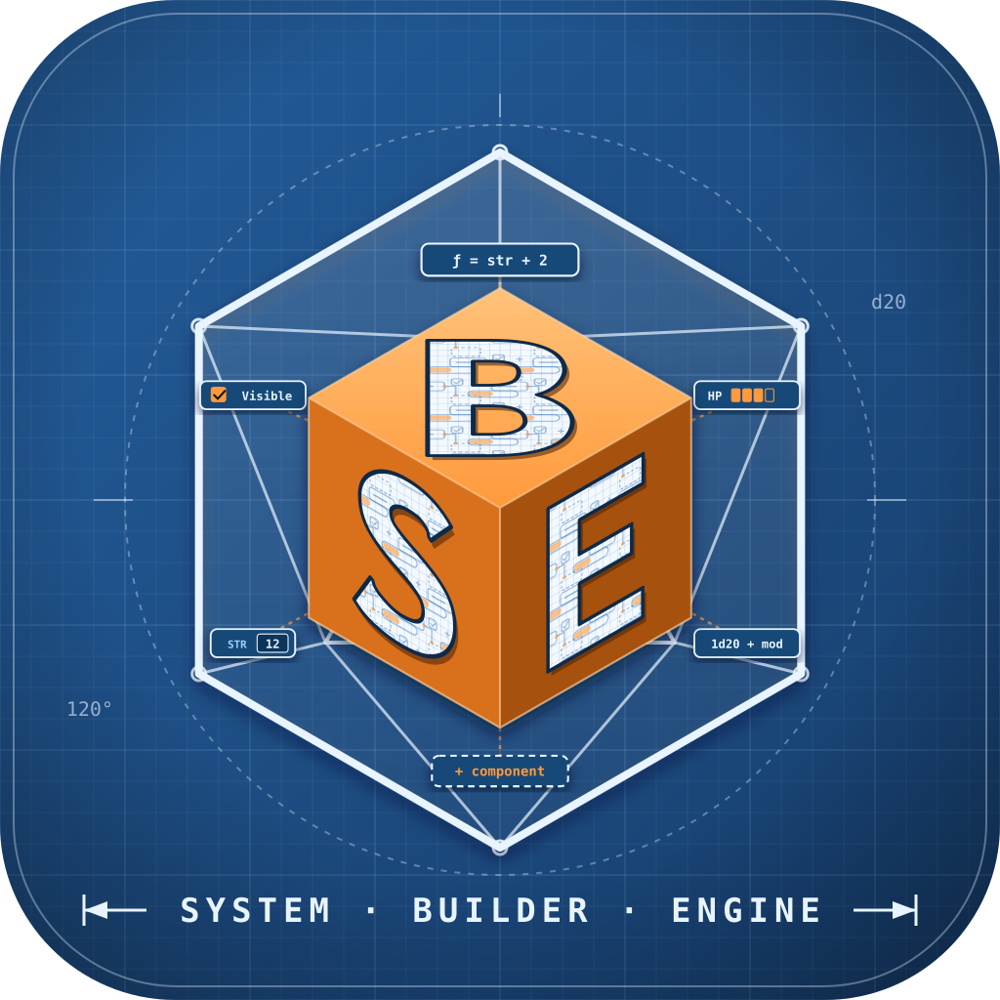

<div align="center">



# SBE — System Builder Engine

**Build your own tabletop RPG system in Foundry VTT — no code required.**<br>
**Créez votre propre système de jeu de rôle dans Foundry VTT — sans coder.**

[](https://foundryvtt.com)
[](https://github.com/Deamonos/system-builder-engine/releases/latest)
[](https://github.com/Deamonos/system-builder-engine/commits)
[](https://github.com/Deamonos/system-builder-engine/releases/latest)
[](https://github.com/Deamonos/system-builder-engine/releases)
<br>
[](https://discord.gg/kUY28T8rHj)
[](https://claude.ai/artifact/HWMjKciPgGM8A1DWJVFKNi)
[](LICENSE)
[](#)

**🇬🇧 [English](#-english)** · **🇫🇷 [Français](#-français)**

</div>

---

## 🇬🇧 English

SBE is a system for Foundry VTT v14 that lets you build your own tabletop RPG system — sheets, rules, mechanics and automations — without writing a single line of code.

SBE ships no game rules. It gives you the tools: you design a template in the workshop, then characters and items are created from it and follow its changes.

### Installation

In Foundry VTT: **Game Systems → Install System**, then paste this manifest URL:

```
https://github.com/Deamonos/system-builder-engine/releases/latest/download/system.json
```

Requires Foundry VTT **v14**.

### Getting started

- A guided tour, **Discover SBE**, starts the first time a GM opens a world. Other tours present each family of modules.
- The built-in documentation (French and English) opens from the book icon in window headers.
- A demo adventure (French and English) is included in the compendiums.

### Features

#### Build
- **Workshop**: design character and item sheets by placing components — text, numbers, checkboxes, lists, colors, images, gauges, tables, charts, tabs and columns.
- **Templates**: characters and items follow their template's changes; templates can be exported and imported as `.json` files.
- **Formulas**: values computed from other values, with functions and lookup tables.
- **Step buttons**: chain actions without code — rolls, conditions, damage, effects, sounds, messages.
- **Rolls**: click-to-roll values, critical thresholds, rerolls, roll requests sent to players.
- **Levels and talents**: progression rules, level sheets and talent trees.

#### Play
- **Inventory**: containers, carrying, stacking, equipment slots and a spatial grid.
- **Effects**: timed, stacking and periodic effects, applied by items or by the GM.
- **Combat**: attack profiles, hit locations, attack zones and templates, initiative, and a combat carousel.
- **The world**: calendar, clock, moons and weather; new day; quests; merchants and trades; chests and items on the ground; locks and keys; traps; traces; languages; vision modes.

#### Look
- Theme (dark or light, colors, fonts, textures), per-template themes, HUD, token bars, token looks and pause banner.

#### Tools
- History of actions with undo, a checker that finds broken references, setting exports, guided tours and help on hover.

### Links

- 🗺️ Roadmap: https://claude.ai/artifact/HWMjKciPgGM8A1DWJVFKNi
- 💬 Discord: https://discord.gg/kUY28T8rHj
- 🐞 Bug reports: [Issues](https://github.com/Deamonos/system-builder-engine/issues)

### License

[CC BY-NC-SA 4.0](LICENSE): free to use, share and adapt with credit, for non-commercial purposes only; adaptations must keep the same license.

---

## 🇫🇷 Français

SBE est un système pour Foundry VTT v14 qui permet de construire son propre système de jeu de rôle — fiches, règles, mécaniques et automatisations — sans écrire une ligne de code.

SBE ne fournit aucune règle de jeu. Il fournit les outils : vous dessinez un modèle dans l'atelier, puis les personnages et les objets sont créés depuis ce modèle et suivent ses changements.

### Installation

Dans Foundry VTT : **Systèmes de jeu → Installer un système**, puis collez cette adresse de manifeste :

```
https://github.com/Deamonos/system-builder-engine/releases/latest/download/system.json
```

Nécessite Foundry VTT **v14**.

### Pour commencer

- Une visite guidée, **Découvrir SBE**, se lance la première fois qu'un MJ ouvre un monde. D'autres visites présentent chaque famille de modules.
- La documentation intégrée (français et anglais) s'ouvre depuis l'icône de livre dans l'en-tête des fenêtres.
- Une aventure de démonstration (français et anglais) est fournie dans les compendiums.

### Fonctionnalités

#### Construire
- **Atelier** : dessinez les fiches de personnages et d'objets en plaçant des composants — textes, nombres, cases à cocher, listes, couleurs, images, jauges, tableaux, graphiques, onglets et colonnes.
- **Modèles** : les personnages et les objets suivent les changements de leur modèle ; les modèles s'exportent et s'importent en fichiers `.json`.
- **Formules** : des valeurs calculées à partir d'autres, avec des fonctions et des tables de correspondance.
- **Boutons à étapes** : enchaînez des actions sans code — jets, conditions, dégâts, effets, sons, messages.
- **Jets** : valeurs lancées d'un clic, seuils critiques, relances, demandes de jet envoyées aux joueurs.
- **Niveaux et talents** : règles de progression, fiches de niveaux et arbres de talents.

#### Jouer
- **Inventaire** : conteneurs, portage, empilement, emplacements d'équipement et grille spatiale.
- **Effets** : effets limités dans le temps, cumulables et périodiques, appliqués par les objets ou par le MJ.
- **Combat** : profils d'attaque, localisation des coups, zones et gabarits d'attaque, initiative et carrousel de combat.
- **Le monde** : calendrier, horloge, lunes et météo ; nouvelle journée ; quêtes ; marchands et échanges ; coffres et objets au sol ; verrous et clés ; pièges ; traces ; langues ; modes de vision.

#### Apparence
- Thème (sombre ou clair, couleurs, polices, textures), thème par modèle, HUD, barres de jetons, apparences des jetons et bannière de pause.

#### Outils
- Historique des actions avec annulation, vérificateur de références cassées, export des réglages, visites guidées et aide au survol.

### Liens

- 🗺️ Feuille de route : https://claude.ai/artifact/HWMjKciPgGM8A1DWJVFKNi
- 💬 Discord : https://discord.gg/kUY28T8rHj
- 🐞 Signaler un bug : [Issues](https://github.com/Deamonos/system-builder-engine/issues)

### Licence

[CC BY-NC-SA 4.0](LICENSE) : libre d'utiliser, de partager et d'adapter en citant l'auteur, uniquement à des fins non commerciales ; les adaptations gardent la même licence.
